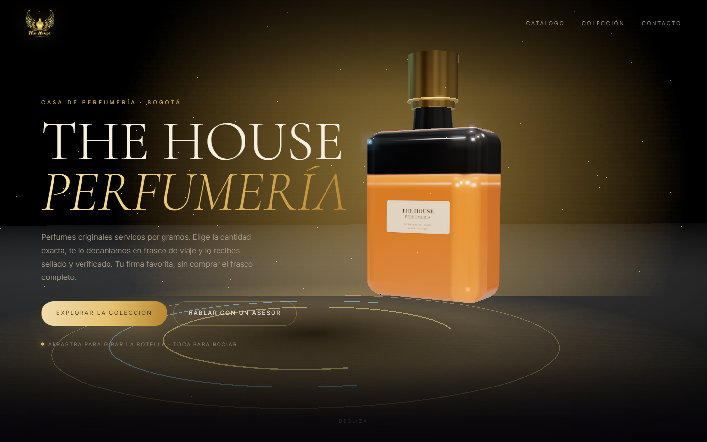

# THE HOUSE PERFUMERÍA — página web 3D



Landing page de perfumería con una escena 3D en WebGL (three.js): botella de
cristal procedural, líquido ámbar, tapón de oro, anillos holográficos, polvo
dorado y suelo reflectante. La escena reacciona al mouse, se puede arrastrar
para girar la botella y al tocarla lanza un chorro de partículas.

## Ver la página en local

La escena usa módulos ES, así que **no funciona abriendo `index.html` con doble
clic** (el navegador bloquea los módulos desde `file://`). Necesita un servidor
local:

**Windows — doble clic en `start.cmd`**

Abre `http://localhost:8080` automáticamente.

O manualmente, desde esta carpeta:

```bat
python -m http.server 8080
```

y visita <http://localhost:8080>.

Alternativas: `npx serve .`, `php -S localhost:8080`, la extensión Live Server
de VS Code, etc.

## Estructura

```
index.html          Marcado y contenido (textos, precios, enlaces)
assets/styles.css   Paleta, tipografía, tarjetas, animaciones de scroll
assets/app.js       Escena three.js + interacciones
assets/logo-the-house.png   Logotipo de la marca (fondo transparente)
assets/productos/   Fotos del catálogo (WebP optimizado)
serve.py            Servidor local con apertura automática del navegador
start.cmd           Lanzador para Windows
```

## Agregar un producto al catálogo

1. Guarda la foto en `assets/productos/` (cuadrada, mínimo 800×800 px).
2. Conviértela a WebP para que pese poco (por ejemplo con Squoosh o `cwebp`).
3. En `index.html`, dentro de `<div class="grid grid--catalog">`, duplica el
   bloque `<article class="product" data-unit="…" data-name="…">…</article>`.
   Cambia: imagen, marca, nombre, descripción, el **precio por gramo** (en
   `data-unit`), y el texto del enlace de WhatsApp.
4. Los botones de gramos (`5 g / 10 g / 15 g / 30 g`) se pueden ampliar o
   cambiar dentro del bloque; `assets/catalog.js` calcula el total y arma el
   mensaje de WhatsApp automáticamente al hacer clic.
5. La rejilla se acomoda sola: 2 columnas cuando hay pocos productos y más
   cuando el catálogo crece.

El modelo del sitio es **venta por gramos**: cada tarjeta muestra el precio por
gramo y el total según la cantidad elegida.

## Personalizar

| Qué | Dónde |
| --- | --- |
| Nombre de la marca, textos, precios, enlaces de contacto | `index.html` |
| WhatsApp de la tienda (usado por el selector de gramos) | `assets/catalog.js` → `PHONE` |
| Colores (dorado, fondo, tipografía) | `assets/styles.css` → `:root` |
| Color del perfume y del tapón | `assets/app.js` → `liquidMat` / `gold` |
| Velocidad de giro, anillos, polvo | `assets/app.js` → `animate()` y `buildRings()` |
| Versión de three.js | `index.html` → bloque `importmap` (fijada en 0.169.0) |

Los datos de contacto del HTML (WhatsApp, Instagram, correo) son de ejemplo:
cámbialos antes de publicar.

## Publicar

- La escena carga three.js desde unpkg (CDN), así que necesita internet; la
  versión está fijada para que no se rompa con actualizaciones.
- **GitHub Pages**: en un repositorio privado, Pages solo está disponible con
  planes de pago. Si el repo se hace público, se activa en
  *Settings → Pages → Deploy from a branch → main / (root)*.
- Alternativas gratuitas con repos privados: Netlify, Vercel o Cloudflare Pages
  (arrastrar la carpeta o conectar el repo; no requiere build).

## Notas técnicas

- three.js r169: `MeshPhysicalMaterial` con transmisión para el cristal,
  `Reflector` para el suelo, `UnrealBloomPass` + `OutputPass` para el brillo.
- Rendimiento: el pixel ratio se limita a 2, el render se pausa cuando la
  pestaña no está visible y se respeta `prefers-reduced-motion` (sin giro
  automático, sin partículas animadas, sin transiciones).
- Accesibilidad: estructura semántica, `aria-label` en la navegación, foco
  visible del navegador y contenido legible sin la escena 3D.
- Si WebGL falla o el CDN no responde, se muestra un fondo degradado y un
  aviso con las instrucciones del servidor local.
